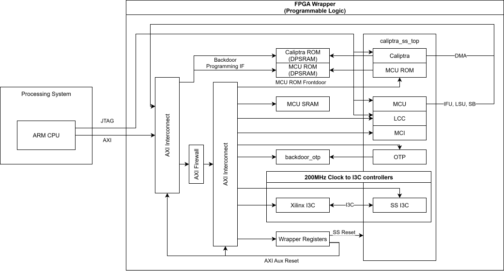

_*SPDX-License-Identifier: Apache-2.0<BR>
<BR>
<BR>
Licensed under the Apache License, Version 2.0 (the "License");<BR>
you may not use this file except in compliance with the License.<BR>
You may obtain a copy of the License at<BR>
<BR>
http://www.apache.org/licenses/LICENSE-2.0 <BR>
<BR>
Unless required by applicable law or agreed to in writing, software<BR>
distributed under the License is distributed on an "AS IS" BASIS,<BR>
WITHOUT WARRANTIES OR CONDITIONS OF ANY KIND, either express or implied.<BR>
See the License for the specific language governing permissions and<BR>
limitations under the License.*_<BR>

# **Caliptra FPGA Guide** #
FPGA provides a fast environment for software development and testing that is built on Caliptra Core and Subsystem RTL.
The ARM CPU takes the place of an SOC manager and can drive stimulus to Caliptra SS over an AXI bus. In addition the Caliptra Core, MCU, and LCC JTAGs are connected to GPIO pins for debug and testing from the ARM CPU.

### FPGA Block Diagram Components ###
- Wrapper Registers
  - Controls resets, straps, and FPGA wrapper utilities such as the log and debug FIFOs.
- AXI Interconnect
  - SS requires the integrator to connect the various SS AXI busses to an interconnect to allow MMIO access both from the SOC manager and SS components with an AXI manager interface.
- Backdoor memory interfaces
  - The Caliptra Core, MCU, and OTP ROMs are implemented as dual port SRAM's to allow them to be reconfigured without rebuilding. These SRAMs are mapped into the ARM CPU to allow them to be written by the hw-model before taking SS out of reset.
- Xilinx I3C
  - The FPGA instantiates an I3C host controller to communicate with the SS I3C. In order for the I3C controllers to reach I3C bus speeds a higher clock is needed. The FPGA modifies caliptra_ss_top to insert CDC logic and run the SS I3C at the same clock.
- Firmware update devices
  - Two flash controllers backed by on-chip RAM, an AXI CDMA, and a small RV32 core that Caliptra releases from reset. See [Firmware update devices](#firmware-update-devices).



### Requirements: ###
 - Vivado
   - Version v2022.2 or 2024.2
 - PetaLinux Tools
   - Version must match Vivado
 - FPGA
   - [VCK190](https://www.xilinx.com/products/boards-and-kits/vck190.html)

### Versal ###
#### Processing system one time setup: ####
1. Download VCK-190 image
   - **Recommended**: A development image is built each week and uploaded by [this](https://github.com/chipsalliance/caliptra-sw/actions/workflows/fpga-image.yml) GitHub Action Job. You will want the image with the `-dev` postfix. This image is an almost exact replica of the image used for the Caliptra CI.
     - This is a debian based image and should make a similar user experience to the AMD image.
   - Ubuntu VCK190 SD card image and install to a microSD card. The Versal is packaged with a blank microSD card in the box that can be used for the OS.
1. Insert the OS SD card into the slot on top of the board.
  - The slot below the board is for the System Controller and the card there should be left inserted.
  - https://ubuntu.com/download/amd-xilinx
1. Configure SW1 to boot from SD1: [Image](./images/versal_boot_switch.jpg)
   - Mode SW1[4:1]: OFF, OFF, OFF, ON
1. Boot from the SD card.
   - Initial boot requires connecting over serial. The first serial port is for the PS. See below for settings.
   - Initial credentials (when using Ubuntu image)
     - User: ubuntu Pass: ubuntu
   - Update the date to avoid apt/git failures
     ```
     sudo dpkg-reconfigure tzdata
     sudo date -s 'yyyy-mm-dd hh:mm'
     ```
   - Install software dependencies - *Do not update the system*
     ```shell
     sudo apt update
     sudo apt install make gcc
     ```
   - Install rustup using Unix directions: https://rustup.rs/#
     ```
     curl --proto '=https' --tlsv1.2 -sSf https://sh.rustup.rs | sh
     ```
   - [Optional] Assign a hostname for SSH access.
   - [Optional] Save uboot environment variables to avoid the MAC being randomized each boot.
     - When connected to the serial port interrupt uboot at the message "Hit any key to stop autoboot:  0"
     - Issue ```saveenv``` command to uboot, which creates an env file in the boot partition for use in subsequent boots.

#### Serial port configuration: ####
The USB Type-C connecter J207 on the VCK190 provides UART and JTAG access to the board using an FTDI USB to quad UART/Serial converter.
1. VCK190 JTAG chain for waveform capture and management.
2. PS UART (First COM port) is a serial port used to access the operating system running on the ARM core.
3. PL UART (Currently unused)
4. System Controller UART (Third COM port)

Serial port settings for the PS UART:
 - Speed: 115200
 - Data bits: 8
 - Stop bits: 1
 - Parity: None
 - Flow control: None

### FPGA build steps: ###
The FPGA build process uses Vivado's batch mode to procedurally create the Vivado project using fpga_configuration.tcl and optionally create the caliptra_build/caliptra_fpga.xsa needed for the next step.
This script provides a number of configuration options for features that can be enabled using "-tclargs OPTION=VALUE OPTION=VALUE"

`vivado -nolog -nojournal -mode batch -source fpga_configuration.tcl -tclargs BUILD=TRUE`

| Option      | Purpose
| ------      | -------
| BUILD=TRUE  | Automatically start building the FPGA.
| GUI=TRUE    | Open the Vivado GUI.

### Build boot.bin: ###

Note: If using the Calptra CI Image (or PetaLinux image), you can skip this step. Instead use a segmented bitstream and load the PDI file directly.

Here is a link with more information about segmented bitstreams: https://github.com/Xilinx/Vivado-Design-Tutorials/tree/2024.2/Versal/Boot_and_Config/Segmented_Configuration

 - Source PetaLinux tools from the PetaLinux installation directory. *PetaLinux Tools must match Vivado version*
   - `source settings.sh`
 - Execute [create_boot_bin.sh](create_boot_bin.sh) to create a BOOT.BIN
   - `./create_boot_bin.sh caliptra_build/caliptra_fpga.xsa`
 - (Optional) After the BOOT.BIN is created once, update_boot_bin.sh can be used to incorporate a new xsa.
   - `./update_boot_bin.sh caliptra_build/caliptra_fpga.xsa`
 - Copy petalinux_project/images/linux/BOOT.BIN to the boot partition as boot1900.bin
   - If the Ubuntu image is booted, it will mount the boot partition at /boot/firmware/
   - If boot1900.bin fails to boot the system will fallback to the default boot1901.bin
   - [!WARNING]
     ```reboot``` seems to skip the image selector and will load from the same filename as the previous boot. If the fallback image is the last one booted then the proper procedure is ```shutdown``` and to toggle the power switch. In the serial boot log the fallback image uses PLM from 2022 while for any valid Caliptra FPGA image the PLM will be 2024.
   ```shell
   sudo su
   cp BOOT.BIN /boot/firmware/boot1900.bin
   reboot
   # OR
   shutdown
   # Toggle power switch
   ```

- Verify the correct image is loaded by checking FPGA wrapper registers.
   - fpga_magic (0xA4010000) contains 0x52545043.
   - fpga_version (0xA4010004) contains the hash of the git HEAD commit.

### Compiling and running Caliptra tests for the FPGA: ###

Please checkout the FPGA section of the MCU [spec](https://chipsalliance.github.io/caliptra-mcu-sw/fpga.html).

### Adding registers to the FPGA wrapper. ###
The FPGA wrapper module contains several registers that interface with the
hardware model to enable various test cases to drive signals/data in/out of the
Caliptra Subsystem toplevel. To add additional registers simply:

1. Ensure you have the `peakrdl` and `peakrdl-markdown` python packages installed: `pip install peakrdl peakrdl-markdown`.
2. Modify the RDL file in `hw/rev-2_1/fpga/src/caliptra_fpga_realtime_regs.rdl` to add the new register descriptions.
3. rerun the autogeneration script:
    a. `cd hw/rev-2_1/fpga/src`
    b. `./gen.sh`
4. [optional]: connect the new registers Caliptra Subsystem toplevel if needed
5. Rebuild the bitstream. 

### Common Issues ###
- Caliptra logic missing or system hang when attempting to access FPGA Wrapper
  - ```sudo shutdown now``` and use power switch to reboot system
- Failures accessing GitHub or package repositories
  - Date incorrect. Fix date using: ```sudo date -s 'yyyy-mm-dd hh::mm'```

### Processing System - Programmable Logic interfaces ###
[FPGA Wrapper Registers](fpga_wrapper_regs.md)

#### Versal Memory Map ####
| IP/Peripheral                       | Accessibility        | Address size | Start address | End address |
| :---------------------------------- | -------------------- | :----------- | :------------ | :---------- |
| Caliptra core ROM Backdoor          | Always               | 96 KiB       | 0xB000_0000   | 0xB001_7FFF |
| MCU ROM Backdoor                    | Always               | 128 KiB      | 0xB002_0000   | 0xB003_FFFF |
| MCU ROM AXI Sub (provided by SS)    | cptra_ss_rst_b       | 128 KiB      | 0xB004_0000   | 0xB005_FFFF |
| MCU SRAM                            | Always               | 96 KiB       | 0xB008_0000   | 0xB005_FFFF |
| FPGA Wrapper Registers              | Always               | 64 KiB       | 0xA401_0000   | 0xA401_FFFF |
| SS I3C                              | cptra_ss_rst_b       | 8 KiB        | 0xA403_0000   | 0xA403_1FFF |
| LCC                                 | cptra_ss_rst_b       | 8 KiB        | 0xA404_0000   | 0xA404_1FFF |
| OTP                                 | cptra_ss_rst_b       | 8 KiB        | 0xA406_0000   | 0xA406_1FFF |
| Xilinx I3C                          | cptra_ss_rst_b       | 4 KiB        | 0xA408_0000   | 0xA408_0FFF |
| AXI CDMA                            | Always               | 4 KiB        | 0xA408_1000   | 0xA408_1FFF |
| AXI Firewall Control                | Always               | 4 KiB        | 0xA409_0000   | 0xA409_0FFF |
| Caliptra                            | SS reset to Caliptra | 1 MiB        | 0xA410_0000   | 0xA41F_FFFF |
| MCI                                 | cptra_ss_rst_b       | 16 MiB       | 0xA800_0000   | 0xA8FF_FFFF |
| Staging SRAM                        | Always               | 256 KiB      | 0xB00C_0000   | 0xB00F_FFFF |
| SoC core SRAM                       | Always               | 8 KiB        | 0xB400_0000   | 0xB400_1FFF |
| Primary hardware flash contents     | Always               | 4 MiB        | 0xB500_0000   | 0xB53F_FFFF |
| Secondary hardware flash contents   | Always               | 4 MiB        | 0xB600_0000   | 0xB63F_FFFF |

The same addresses apply to every AXI manager: the ARM core, the MCU, the Caliptra DMA and the AXI CDMA.

### Firmware update devices ###
These devices let firmware update flows run on the FPGA with real hardware behind the flash and DMA registers: two flash controllers, the AXI CDMA, and a small SoC core that stands in for an SoC component whose firmware the MCU loads and Caliptra releases from reset.

The `fpga_features` wrapper register (0xA401_0300) reports them. Bit 0 is the hardware flash controllers, bit 1 the CDMA interrupt and `cdma_axi_user`, bit 2 the SoC core. It reads as 0 on bitstreams that do not have them.

#### Hardware flash controllers ####
`primary_hw_flash_ctrl_regs` (0xA401_4000) and `secondary_hw_flash_ctrl_regs` (0xA401_5000) have the same register layout as the software-serviced `primary_flash_ctrl_regs` (0xA401_2000) and `secondary_flash_ctrl_regs` (0xA401_3000), which is in [fpga_wrapper_regs.md](fpga_wrapper_regs.md). The two pairs are separate register blocks and do not conflict: the host services the software-serviced pair, and only the RTL services the hardware pair. Both can be used in the same boot.

Each hardware controller is backed by 4 MiB of UltraRAM and runs the operations itself ([fpga_hw_flash.sv](src/fpga_hw_flash.sv)). To run one, write the page number to `PAGE_NUM`, then write `FL_CONTROL` with `OP` in bits 2:1 and `START` in bit 0:

| OP | Operation
| -- | ---------
| 1  | Read the 256 byte page `PAGE_NUM` into `FLASH_BUF`.
| 2  | Write `FLASH_BUF` to the 256 byte page `PAGE_NUM`. The page is overwritten, so no erase is needed first.
| 3  | Erase the 4 KiB sector that contains page `PAGE_NUM` to 0xFF.

When the operation ends, the controller clears `START` and sets `OP_STATUS.DONE` (bit 0) and `FL_INTERRUPT_STATE.EVENT` (bit 1). If it failed, `OP_STATUS.ERR` (bits 3:1) is 1 for a read, 2 for a write or 4 for an erase, and `FL_INTERRUPT_STATE.ERROR` (bit 0) is set. `OP_STATUS` keeps its value until software writes it, so clear it before the next operation.

Differences from the software-serviced registers:
 - `FL_INTERRUPT_STATE` bits are cleared by writing 1.
 - `CTRL_REGWEN` is read-only and is low while an operation runs.
 - `FLASH_SIZE` is read-only.
 - An operation fails if `PAGE_NUM` is past the end of the flash or `PAGE_SIZE` is less than 256. A page is always 256 bytes.
 - An erase clears a 4 KiB sector.

The flash reads as 0xFF after the bitstream is loaded and keeps its contents until the next load. The contents are also mapped on the AXI bus at 0xB500_0000 (primary) and 0xB600_0000 (secondary), so the host can load or inspect an image, and the AXI CDMA or the Caliptra DMA can read it without going through the page buffer.

#### AXI CDMA ####
The block design has an AMD AXI CDMA (AMD product guide PG034) in simple mode at 0xA408_1000. It can copy between any two AXI addresses in the memory map, for example from the flash contents to the SoC core SRAM. `cdma_introut` is MCU external interrupt 8.

| Offset | Register | Use
| ------ | -------- | ---
| 0x00   | `CDMACR` | Bit 2 soft reset (reads 1 until done), bit 12 completion interrupt enable, bit 14 error interrupt enable.
| 0x04   | `CDMASR` | Bit 1 idle, bit 4 internal error, bit 5 subordinate error, bit 6 decode error, bit 12 completion interrupt and bit 14 error interrupt (write 1 to clear).
| 0x18   | `SA`     | Source address.
| 0x20   | `DA`     | Destination address.
| 0x28   | `BTT`    | Bytes to transfer. Writing it starts the transfer.

A transfer is done when `CDMASR` bit 1 is set. After an error the CDMA stays halted until a soft reset.

The `cdma_axi_user` wrapper register (0xA401_030C) sets the AxUSER value of the CDMA's transfers, for subordinates that check it. MCI serves the MCU SRAM execution region only to the MCU users (the `lsu_user` and `ifu_user` wrapper registers) while `SS_GENERIC_FW_EXEC_CTRL[2]` is set, and only to the SRAM configuration user (`sram_config_user`) while it is clear.

Do not start a transfer to or from a subordinate that is in reset. The Accessibility column of the memory map shows which ones can be; the flash contents, the SoC core SRAM and the staging SRAM are always accessible. The CDMA sends the destination write address before it has read data, so while the source does not answer, the write burst stays open and other writers to that destination wait behind it. A host access that never completes stops the ARM core that made it, and the board then needs a power cycle.

#### SoC core ####
[fpga_soc_core.sv](src/fpga_soc_core.sv) is a PicoRV32 (RV32IMC) with 8 KiB of SRAM. The core starts at address 0 of its SRAM, which is loaded over the AXI bus at 0xB400_0000. The SRAM can be loaded while the core is in reset.

| Wrapper register | Address | Fields
| ---------------- | ------- | ------
| `soc_core_control` | 0xA401_0304 | Bits 6:0 `exec_bit` (default 3), bit 8 `force_reset`, bit 9 `force_run`
| `soc_core_status`  | 0xA401_0308 | Bit 0 `rst_b` (1 when the core is out of reset), bit 1 `trap`
| `fw_exec_ctrl[4]`  | 0xA401_0310 | Mirror of `SS_GENERIC_FW_EXEC_CTRL`, 32 bits per word

The core is held in reset until Caliptra sets the bit of `SS_GENERIC_FW_EXEC_CTRL` selected by `exec_bit`. For bring-up, `force_run` releases the core whatever that bit is, and `force_reset` holds it in reset and wins over `force_run`. `trap` is set when the core stops on an illegal instruction, a misaligned access or an `ebreak`, and is cleared by a reset of the core.

The core has one FIFO of bytes in each direction: 1024 bytes towards the host and 64 bytes towards the core. A byte written to a full FIFO is dropped. The other end is in the wrapper registers, which the host and the MCU can both reach:

| Core address | Core register | Wrapper register
| ------------ | ------------- | ----------------
| 0x1000_0000  | `DATA_OUT`: write a byte | `soc_fifo_pop` (0xA401_1028): bit 8 valid, bits 7:0 data. Reading removes the byte.
| 0x1000_0004  | `DATA_IN`: bit 8 valid, bits 7:0 data. Reading removes the byte. | `soc_fifo_push` (0xA401_102C): write a byte
| 0x1000_0008  | `STATUS`: bit 0 `DATA_OUT` full, bit 1 `DATA_OUT` empty, bit 2 `DATA_IN` empty, bit 3 `DATA_IN` full | `soc_fifo_status` (0xA401_1030): bit 0 `DATA_OUT` empty, bit 1 `DATA_OUT` full, bit 2 `DATA_IN` empty, bit 3 `DATA_IN` full

[tb/soc_core_fw](tb/soc_core_fw) is a small Rust firmware that writes a banner to `DATA_OUT` and echoes what it receives.

PicoRV32 is vendored in [third_party/picorv32](third_party/picorv32) under the ISC license.

#### MCU external interrupts ####
| Interrupt | Source
| --------- | ------
| 3         | Spare I3C core
| 4         | `primary_flash_ctrl_regs`
| 5         | `secondary_flash_ctrl_regs`
| 6         | `primary_hw_flash_ctrl_regs`
| 7         | `secondary_hw_flash_ctrl_regs`
| 8         | AXI CDMA

#### Host access ####
`io_module.ko` registers the UIO device `caliptra-fpga-uio-dev2` with these mappings:

| Mapping | Contents | Address | Size
| ------- | -------- | ------- | ----
| 0 | SoC core SRAM | 0xB400_0000 | 8 KiB
| 1 | Primary hardware flash contents | 0xB500_0000 | 4 MiB
| 2 | Secondary hardware flash contents | 0xB600_0000 | 4 MiB
| 3 | Staging SRAM | 0xB00C_0000 | 256 KiB
| 4 | AXI CDMA registers | 0xA408_1000 | 4 KiB

The wrapper registers named above are inside the `fpga_wrapper` mapping of the first UIO device.

#### Simulation ####
`tb/run_sim.sh` builds the test firmware and simulates the flash controllers and the SoC core with the Vivado simulator. It needs Vivado and cargo (the firmware's `rust-toolchain.toml` selects the `riscv32imc-unknown-none-elf` target), and prints `TEST PASSED` on success.

### Waveform Debug ###
If built with DEBUG=TRUE common signals for debug will be connected to ILAs. In addition images may be built with additional debug signals. This is a general procedure for loading a probes file when consuming an image built by someone else. If the image was built locally, this is unnecessary because the probes file will be loaded automatically.
- Open Vivado 2024.2. Under "Tasks" there is an option for "Open Hardware Manager"
- Open target
  - If the machine running Vivado is directly connected over USB it can be opened automatically. Alternatively Vivado can connect to a remote host running the hw-server that is connected to the FPGA.
- Load the ltx
  - Under the "Hardware Device Properties" menu specify the "Probes file" by selecting the "..." button on the right.
- Open the ILA in the main window to view the waveform window.

### JTAG debug
Requirements:
- Security state must have either debug_locked == false or lifecycle == manuf.
- Set "debug = true" in firmware profile to provide line information to GDB.
- openocd 0.12.0 (must be configured with --enable-sysfsgpio)
- gdb-multiarch

#### Debugger launch procedure ####
JTAG connectivity is provided using EMIO GPIO pins bridging the PS and PL. OpenOCD is run on the ARM core and uses SysFs to interface with the GPIO pins. The Caliptra, MCU, and LCC JTAGs are each connected to their own set of EMIO pins and can be used independently.
1. Invoke OpenOCD server
    - `./caliptra-mcu-sw/hw/rev-2_1/fpga/launch_openocd.sh [core/mcu/lcc]`
1. Connect client(s) for debug
    - GDB: `gdb-multiarch [bin] -ex 'target remote localhost:3333'`
    - Telnet: `telnet localhost 4444`

#### Caliptra SoC interface registers ####
Over Telnet connection to OpenOCD: `riscv.cpu riscv dmi_read [addr]`

#### JTAG testing ####
Test requirements for both OpenOCD and GDB:
- JTAG port is accessible when debug_locked == true or lifecycle == manufacturing. The port is inaccessible otherwise.
- Read access to ROM space using 8, 16, 32, and 64 bit reads.
- Read and write access to DCCM using 8, 16, 32, and 64 bit accesses.
- Access to ICCM using 32 and 64 bit reads, 32 bit writes.
- Access to VEER core registers.
- HW and SW breakpoints halt the CPU.
- Watchpoints on DCCM and Caliptra register access halt the CPU.
 
Test requirements exclusive to GDB:
- Basic commands all work (step, next, frame, info, bt, ni, si, etc.).
 
Test requirements exclusive to OpenOCD:
- Basic commands all work (reg, step, resume, etc.).
- Access to VEER CSRs.
- Access to Debug Module registers.
- Caliptra registers exposed to JTAG RW/RO status matches.
